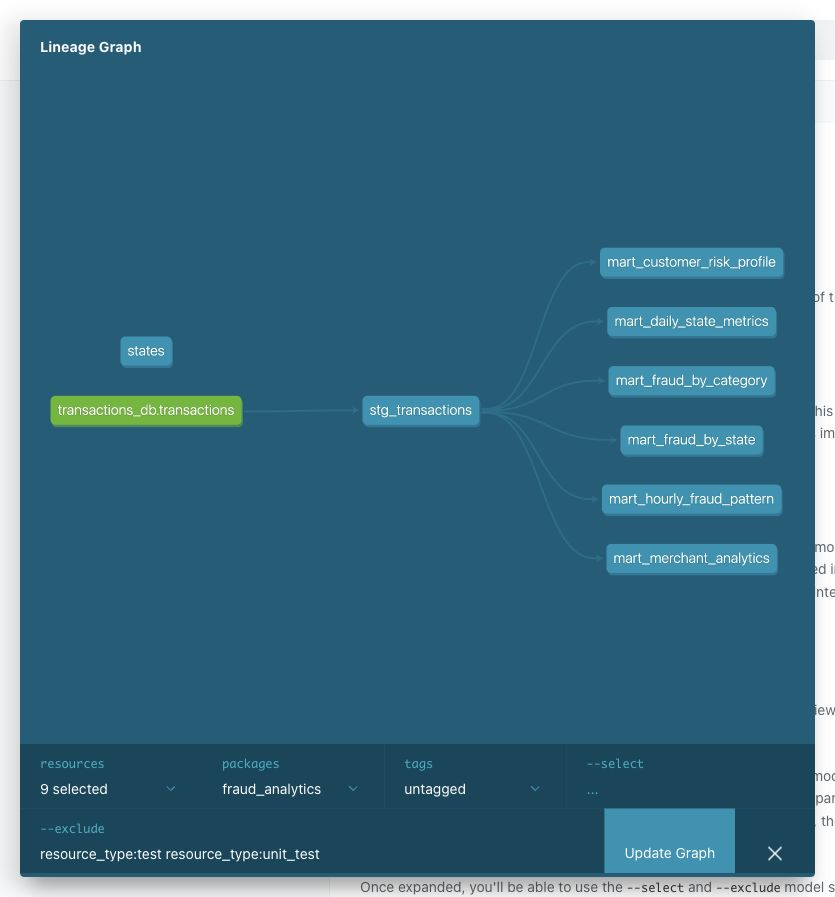

# Аналитика транзакций в dbt

Проект загружает транзакции в ClickHouse, обрабатывает их через dbt и строит шесть аналитических витрин. Используются те же данные, что и в HW2.

## Данные

Нужно скачать два файла из [соревнования teta-ml-1-2025 на Kaggle](https://www.kaggle.com/competitions/teta-ml-1-2025/data):

- `train.csv` — транзакции с меткой мошенничества `target`;
- `test.csv` — транзакции без этой метки.

Оба файла нужны целиком, с исходными названиями. Другие файлы соревнования для запуска не нужны.

## Как запустить

Нужны запущенный Docker с Compose v2, Make, около 4 ГБ свободной памяти и свободный порт 8084.

Сначала нужно склонировать репозиторий и создать папку для данных:

```bash
git clone https://github.com/Ilya-Shn/il_shein_ml_ops_hw4.git
cd il_shein_ml_ops_hw4
mkdir -p data
```

Скачанные CSV нужно положить в `data/`. Должно получиться так:

```text
data/
├── train.csv
└── test.csv
```

Затем из папки репозитория нужно выполнить:

```bash
make all
```

Команда соберёт Docker-образ, запустит ClickHouse, загрузит оба CSV и установит пакеты dbt. После этого создаст справочник штатов и все витрины, запустит тесты и проверку SQL, сверит результаты с CSV и сгенерирует документацию. При первом запуске нужно дождаться установки всех зависимостей.

Когда `make all` завершится без ошибок, документацию можно открыть отдельной командой:

```bash
make serve
```

Страница будет доступна по адресу [http://localhost:8084](http://localhost:8084). В ней есть описания моделей, столбцов, тестов и граф зависимостей. Терминал с `make serve` должен оставаться открытым; остановить сервер можно через `Ctrl+C`.

Отдельные команды: `make run` строит витрины, `make test` запускает тесты dbt, `make lint` проверяет SQL, `make verify` сверяет результаты с CSV, а `make docs` обновляет документацию.

После замены CSV нужно выполнить `make load run test verify docs`. Повторная загрузка заменяет исходную таблицу, поэтому строки не дублируются.

Для остановки ClickHouse используется `make down`. Загруженные данные сохраняются в Docker volume. Логин и пароль ClickHouse — `fraud` / `fraud`; база доступна внутри сети Docker.

## Что считается

Данные проходят через `transactions_db.transactions` → `stg_transactions` → витрины в базе `analytics`. В staging приводятся типы, убираются пробелы по краям строк, добавляются дата, час, день недели, ключ клиента и группа суммы.

- `mart_daily_state_metrics` — количество и сумма транзакций, средний чек, P95 и доля крупных транзакций по дням и штатам.
- `mart_fraud_by_category` — количество транзакций и случаев мошенничества, доля фрода и суммы по категориям.
- `mart_fraud_by_state` — те же показатели по штатам, а также количество клиентов и мерчантов.
- `mart_customer_risk_profile` — первая и последняя транзакции клиента, средний чек, суммы и уровень риска.
- `mart_hourly_fraud_pattern` — показатели фрода по дням недели и часам, отметка периодов с долей фрода выше общей.
- `mart_merchant_analytics` — оборот мерчанта, доля фрода, количество клиентов и признак подозрительности.

Доля фрода считается в процентах только по строкам с известным `target`. В `test.csv` метки нет, поэтому она остаётся NULL. Эти транзакции учитываются в обороте и среднем чеке. В данных есть 50 штатов и округ DC; время обрабатывается как UTC.

Ключ клиента строится по имени, фамилии, улице и почтовому индексу. Уровень риска: HIGH при доле фрода от 5%, MEDIUM — от 1%, LOW — меньше 1%. Если известных меток нет, используется UNKNOWN. Мерчант отмечается как подозрительный, если у него не менее 100 размеченных транзакций и доля фрода от 1%.

Макрос `amount_bucket` делит суммы на SMALL (<100), MEDIUM (от 100 до 1000, не включая 1000) и LARGE (от 1000). Макрос `fraud_metrics` используется для общего расчёта показателей фрода. Пакет `dbt_utils` нужен для ключа клиента и проверки уникальности, `dbt_date` — для дня недели, `dbt_expectations` — для проверки диапазонов значений.

Версии: dbt-core **1.10.15**, dbt-clickhouse **1.9.8**, ClickHouse **25.8.4.13**, SQLFluff **4.5.0**. Версии пакетов dbt указаны в `dbt/packages.yml` и `dbt/package-lock.yml`.

## Проверки

Локально обработаны все **1 048 575 строк**, из них 786 431 с известной меткой и 4 504 случая фрода. Все **97 тестов dbt** прошли без ошибок и предупреждений. SQLFluff и pre-commit также прошли.

Тесты `not_null`, `unique`, `accepted_values` проверяют заполненность, уникальность и допустимые значения. Для витрин проверяется уникальность ключей. Также проверяется, что коды штатов есть в справочнике. Отдельные SQL-тесты проверяют суммы, сохранение строк и меток, доли и признаки риска. Три unit tests проверяют обработку строк и границы сумм, расчёт доли фрода без неизвестных меток и уровни риска клиента.

`make verify` рассчитывает показатели отдельно в Python по исходным CSV и сравнивает их со всеми шестью витринами, включая P95, количество уникальных клиентов и мерчантов, даты и признаки риска. Сохранены [результаты сверки и SHA-256 файлов](results/check.json) и [лог dbt test](results/dbt_test.log).

Для проверки SQL настроен SQLFluff с диалектом ClickHouse и шаблонизатором dbt. Отключены проверки регистра функций и типов, зарезервированных имён и порядка полей (`CP03`, `CP05`, `RF04`, `ST06`).

Чтобы SQL проверялся перед коммитом, нужно установить pre-commit на компьютере:

```bash
python3 -m venv .venv
.venv/bin/pip install pre-commit==4.3.0
.venv/bin/pre-commit install
PATH="$PWD/.venv/bin:$PATH" make pre-commit
```

Проверка запускается в Docker. Для неё нужны работающий ClickHouse и установленные пакеты dbt — они уже готовы после `make all`.


